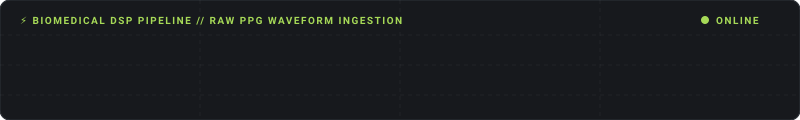

<div align="center">


<a href="https://git.io/typing-svg">
  
</a>

<br/>


<br/><br/>

[](YOUR_PORTFOLIO_LINK)
[](YOUR_LINKEDIN_LINK)
[](mailto:adaktanuja@gmail.com)
[](YOUR_TECHRXIV_LINK)

<br/>



</div>

---

## 👩‍💻 About Me

```python
class Tanuja:
    def __init__(self):
        self.role      = "ML & Full-Stack Developer"
        self.education = "B.Tech CSE, Krishna Vikas Institute of Technology (2022-2026)"
        self.location  = "Raipur, India 🇮🇳"
        self.research  = "PPG Signal Quality Assessment (TechRxiv, IEEE-supported)"
        self.focus     = ["Machine Learning", "Deep Learning", "MERN Stack"]
        self.looking_for = "Entry-level ML / Python opportunities"

    def say_hi(self):
        print("Let's build something that matters! ✨")
```

- 🔬 Architected end-to-end AI pipelines, from raw biomedical signals to deployed classifiers
- 🌱 Built apps that put AI in the hands of everyday users, like farmers reading soil health cards
- 🧩 Love making complex ideas visible, interactive and fun (see Algo Learner Studio)
- 🏆 IDEA-FIESTA Hackathon Finalist (2022)

---

## 🛠️ Tech Stack

<div align="center">


</div>

| Area | Tools |
|---|---|
| **Languages** | Python, JavaScript |
| **ML & AI** | Machine Learning, Deep Learning, Data Preprocessing, TensorFlow, scikit-learn, Pandas, NumPy |
| **Frontend** | HTML, CSS, React, React Native, Responsive UI Design |
| **Backend** | Node.js, Express.js, REST APIs, FastAPI, JWT Authentication, PostgreSQL |
| **Tools** | VS Code, Jupyter Notebook, Google Colab, Firebase |

---

## 🚀 Featured Projects

### 🫀 PPG Signal Quality Assessment
*Jul 2025 – Aug 2025*

An end-to-end biomedical signal pipeline that ingests raw PPG data, filters noise, extracts features and classifies signal quality in real time.

- Butterworth DSP filters + **30+ statistical features**
- **95% accuracy** with Random Forest, deployed via **FastAPI**
- Mobile companion built with React Native


[🔗 View on GitHub](YOUR_PPG_REPO_LINK)

---

### 🌾 MittiCard: Soil Health App
*Feb 2026 – Apr 2026*

An AI-powered mobile app that scans ICAR Soil Health Cards with **Groq Vision OCR** and delivers crop-specific fertilizer recommendations with cost estimates in **Hindi and English**.

- Advisory system for **7 crops** with NPK deficiency detection and a 0-100 soil health score
- Node.js/Express + PostgreSQL backend with OTP authentication and Firebase push notifications


[🔗 View on GitHub](YOUR_MITTICARD_REPO_LINK)

---

### 🎛️ Algo Learner Studio
*Sep 2026 – Oct 2026*

An interactive visualizer for **15+ data structures and algorithms** (AVL Trees, Heaps, Graphs, DP, Sorting Race) with frame-by-frame playback and synchronized pseudocode.

- Zero-dependency **Web Audio API** synthesizer: pitch-scaled sound on comparisons and rotations
- Live Big-O time and space complexity telemetry


[🔗 View on GitHub](YOUR_ALGO_REPO_LINK)

---

## 💼 Experience

**Machine Learning & Deep Learning Trainee**, IIIT Naya Raipur · *May 2025 – Jul 2025*

- Built a Python preprocessing and feature-extraction pipeline for raw PPG waveforms, reaching **89.7% accuracy** with SVM and Random Forest
- Architected a cross-platform React Native app for real-time biometric monitoring and data visualization

---

## 📄 Publication & Certifications

- 📘 **Tanuja Adak et al.**, *"PPG Signal Quality Assessment & Artifact Detection for Smartphone Monitoring,"* TechRxiv (IEEE-supported preprint), 2025
- 🎓 AI & ML Training, IIIT Naya Raipur (Jul 2025)
- 🎓 Infosys Springboard, AI/ML Certification (2025)
- 🎓 CodeTech IT Solutions, Web Development Certification (2024)

---

## 📊 GitHub Stats

<div align="center">


<br/>


<br/>


<br/>


</div>

---

<div align="center">

### 🤝 Let's Connect

*I'm looking for entry-level Machine Learning and Python development roles. If you're building something with data, signals or smart apps, I'd love to chat!*

📫 **adaktanuja@gmail.com**


</div>
